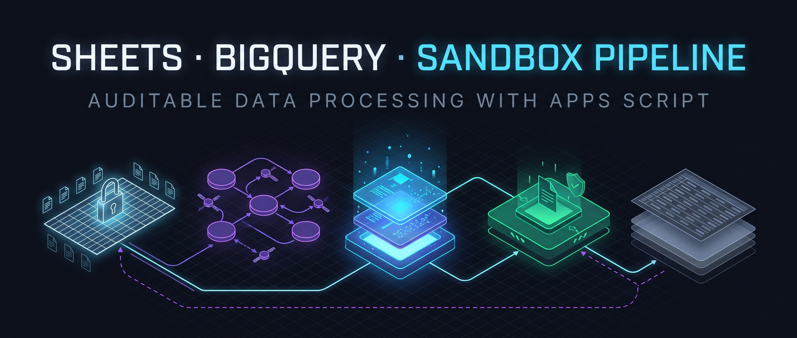

# Google Sheets to BigQuery Sandbox Pipeline

### Externalização controlada do processamento de planilhas com Google Apps Script e BigQuery Sandbox

**Estudo técnico · Prova de conceito validada · Exemplos reproduzíveis**

---

## Visão geral

Este repositório documenta uma prova de conceito sobre a externalização de cálculos, regras, validações e agregações originalmente concentrados em planilhas.

A arquitetura experimental utilizou:

- **Google Sheets** como origem mantida somente para leitura;
- **Google Apps Script** como camada de detecção, controle e orquestração;
- **BigQuery Sandbox** como mecanismo analítico;
- estruturas candidatas e oficiais para promoção controlada;
- ambiente shadow para publicação isolada;
- assinaturas, contagens e auditorias para validação;
- estados persistidos para recuperação de incidentes;
- dados sintéticos nos exemplos reproduzíveis.

A pergunta central foi:

> **Até onde é possível retirar cálculos e regras de uma planilha, processá-los externamente e construir um pipeline recorrente, auditável e recuperável com Google Apps Script e BigQuery Sandbox?**

> [!IMPORTANT]
> Este é um estudo técnico independente e uma prova de conceito. O repositório não representa uma aplicação transacional pronta para produção e não contém dados reais, credenciais, identificadores operacionais ou código de produtos internos.

---

## Navegação

- [Problema estudado](#problema-estudado)
- [Hipótese avaliada](#hipótese-avaliada)
- [Arquitetura experimental](#arquitetura-experimental)
- [Resultados principais](#resultados-principais)
- [Baseline de fórmulas](#baseline-de-fórmulas)
- [Performance](#performance)
- [Consumo do BigQuery](#consumo-do-bigquery)
- [Incidentes e recuperação](#incidentes-e-recuperação)
- [Estrutura do repositório](#estrutura-do-repositório)
- [Reprodução segura](#reprodução-segura)
- [Documentação](#documentação)
- [Aplicabilidade](#aplicabilidade)
- [Limitações](#limitações)
- [Segurança e privacidade](#segurança-e-privacidade)
- [Conclusão](#conclusão)
- [Referências](#referências)
- [Licença](#licença)

---

## Problema estudado

Planilhas são adequadas para exploração, prototipação, análises rápidas e validação de hipóteses.

Entretanto, sua manutenção tende a se tornar mais complexa quando uma única estrutura passa a concentrar simultaneamente:

- dados;
- fórmulas;
- regras;
- buscas;
- normalizações;
- indicadores;
- exceções;
- experiência operacional;
- conhecimento não documentado.

A estrutura analisada apresentava:

- fórmulas replicadas por milhares de linhas;
- buscas massivas;
- regras condicionais aninhadas;
- padrões diferentes de fórmula na mesma coluna;
- células com erro;
- latência variável;
- dificuldade de versionar regras;
- risco de alterações manuais;
- dependência de conhecimento especializado.

### Baseline estrutural

| Métrica | Resultado observado |
|---|---:|
| Linhas | 75.595 |
| Colunas | 35 |
| Células consideradas | 2.645.825 |
| Fórmulas | 146.701 |
| Densidade de fórmulas | 5,54% |
| Colunas com fórmulas | 5 |
| Células apresentando erros | 18 |
| Colunas com padrões misturados | 1 |

### Funções identificadas

| Função | Ocorrências |
|---|---:|
| `IF` | 173.158 |
| `SUBSTITUTE` | 151.188 |
| `VALUE` | 75.594 |
| `XLOOKUP` | 64.523 |
| `COUNTIFS` | 5.129 |
| `IMPORTRANGE` | 1 |

> [!NOTE]
> Uma fórmula pode conter várias funções. Por isso, a soma das ocorrências de funções é superior ao total de fórmulas.

Os detalhes da medição estão em [`evidence/formula-baseline-summary.json`](evidence/formula-baseline-summary.json).

---

## Hipótese avaliada

A hipótese principal foi:

> **É possível manter a planilha de origem somente para leitura, executar limpeza, transformação, regras e agregações no BigQuery e publicar apenas resultados previamente validados?**

O experimento também avaliou:

1. detecção de mudanças sem leitura integral das células;
2. recorrência por gatilhos controlados;
3. persistência de estados;
4. separação entre gerações candidatas e oficiais;
5. bloqueio diante de inconsistências;
6. backups anteriores à promoção;
7. publicação sem fórmulas;
8. auditoria posterior;
9. recuperação sem duplicação;
10. encerramento automático;
11. consumo do BigQuery Sandbox;
12. padrões reutilizáveis em outros contextos.

---

## Arquitetura experimental

O fluxo validado separou a origem, a orquestração, o processamento, a validação e a publicação.

| Camada | Tecnologia ou estrutura | Responsabilidade |
|---|---|---|
| Origem | Google Sheets | Fonte mantida somente para leitura |
| Detecção | Google Apps Script | Leitura de metadados e confirmação de mudanças |
| Orquestração | Google Apps Script | Estados, locks, preflights e controle do ciclo |
| Entrada | BigQuery Sandbox | Estruturas raw e candidatas |
| Transformação | GoogleSQL | Limpeza, normalização e regras |
| Saídas analíticas | BigQuery | Indicadores, divergências e exceções |
| Validação | Contagens e assinaturas | Comparação entre gerações |
| Promoção | Tabelas e views | Substituição controlada da geração oficial |
| Publicação | Ambiente shadow | Valores estáticos e sem fórmulas |
| Auditoria | Apps Script e BigQuery | Integridade, resíduos e estado final |
| Recuperação | Estados e backups | Retomada controlada após incidente |

Fluxo resumido:

**Origem somente leitura → Detecção → Orquestração → Raw → Clean → Rules → Indicators/Exceptions → Auditoria → Shadow → Encerramento**

### Princípios adotados

- origem somente para leitura;
- separação entre candidatas e oficiais;
- nenhuma publicação sem validação;
- backup antes da promoção;
- estados persistidos;
- operações idempotentes;
- assinaturas de conteúdo;
- falha preservada;
- recuperação controlada;
- auditoria posterior;
- remoção seletiva de resíduos;
- ausência de fórmulas nas saídas técnicas.

### Documentos de arquitetura

- [Estado observado](architecture/current-state.md)
- [Fluxo de dados](architecture/data-flow.md)
- [Pipeline experimental](architecture/experimental-pipeline.md)
- [Máquina de estados](architecture/state-machine.md)
- [Arquitetura consolidada](docs/architecture.md)

---

## Resultados principais

A janela automatizada permaneceu ativa por aproximadamente 48 horas.

| Evidência | Resultado |
|---|---:|
| Ciclos operacionais concluídos | 10 |
| Ciclos aprovados | 10 |
| Resultados operacionais acumulados | 32 |
| Resultados aprovados no consolidado | 31 |
| Auditoria automática de integridade | Aprovada |
| Escritas na origem | 0 |
| Fórmulas nas saídas técnicas | 0 |
| Gatilhos residuais ao final | 0 |
| Concessões residuais ao final | 0 |
| Leases residuais ao final | 0 |
| Estado final | Concluído e saudável |

### Capacidades comprovadas

- detecção de mudanças;
- confirmação temporal da mudança;
- captura controlada;
- validação de esquema;
- criação de estruturas candidatas;
- criação e validação de views;
- aplicação de regras;
- backup antes da promoção;
- promoção controlada;
- validação pós-promoção;
- publicação sem fórmulas;
- sanitização de textos;
- assinaturas de conteúdo;
- auditoria automática;
- bloqueio de inconsistências;
- recuperação de incidentes;
- remoção de resíduos;
- encerramento automático.

O consolidado técnico está disponível em [`docs/results.md`](docs/results.md).

As evidências sanitizadas estão disponíveis em:

- [`evidence/experimental-summary.json`](evidence/experimental-summary.json)
- [`evidence/performance-summary.json`](evidence/performance-summary.json)
- [`evidence/test-matrix.md`](evidence/test-matrix.md)

---

## Baseline de fórmulas

A baseline foi coletada durante aproximadamente 24 horas, em modo somente leitura.

| Métrica | Resultado |
|---|---:|
| Intervalo entre amostras | 15 minutos |
| Amostras esperadas | 96 |
| Amostras realizadas | 96 |
| Cobertura | 100% |
| Falhas de coleta | 0 |
| Escritas na origem | 0 |
| Fórmulas inventariadas | 146.701 |
| Células com erro | 18 |

### Erros observados

| Tipo | Quantidade |
|---|---:|
| `#REF!` | 8 |
| `#VALUE!` | 4 |
| `#ERROR!` | 6 |

> [!NOTE]
> Parte da baseline ocorreu fora do expediente. Os resultados representam uma amostra exploratória de curto período e não uma medição definitiva de todos os picos operacionais.

---

## Performance

O consolidado reuniu 30 amostras de etapas persistidas.

| Métrica | Resultado |
|---|---:|
| Média | 12,72 s |
| Mediana | 2,27 s |
| P95 | 62,32 s |
| Mínimo | 0,30 s |
| Máximo | 92,08 s |
| Amostras abaixo da meta interna de 25 s | 86,67% |

**P95** representa a duração abaixo da qual ficaram 95% das amostras observadas.

A diferença entre média e mediana indica que a maioria das etapas foi rápida, enquanto algumas operações mais pesadas elevaram a média.

As etapas mais demoradas estavam associadas a:

- publicação de células no Google Sheets;
- captura de snapshot;
- promoção de estruturas;
- validação pós-promoção;
- recuperação da publicação.

### Publicação observada

| Métrica | Resultado |
|---|---:|
| Linhas publicadas | 9.009 |
| Células publicadas | 114.575 |
| Fórmulas publicadas | 0 |
| Valores sanitizados | 2.340 |
| Duração | 87,4 s |

O principal gargalo observado foi a publicação no Google Sheets, não o processamento analítico no BigQuery.

---

## Consumo do BigQuery

Um ciclo aprovado utilizado como referência apresentou:

| Métrica | Resultado |
|---|---:|
| Jobs | 13 |
| Jobs com processamento | 9 |
| Bytes processados | 88.789.912 |
| Volume processado aproximado | 84,7 MiB |
| Bytes faturáveis informados | 181.403.648 |
| Volume faturável aproximado | 173 MiB |
| Proporção aproximada de 1 TiB | 0,0165% |

O ambiente permaneceu sem faturamento habilitado. A métrica de bytes faturáveis representa o volume que seria considerado pelo modelo sob demanda, não uma cobrança realizada.

### Projeções

| Frequência hipotética | Projeção aproximada |
|---|---:|
| 1 ciclo por dia | 5,1 GiB/mês |
| 12 ciclos por dia | 60,8 GiB/mês |
| 30 ciclos por dia | 152 GiB/mês |
| 96 ciclos por dia | 486,6 GiB/mês |

> [!WARNING]
> As projeções não representam consumo medido nem garantia operacional. Volume, frequência, consultas, tabelas e regras podem alterar significativamente o resultado.

A análise completa está em [`docs/sandbox-and-billing.md`](docs/sandbox-and-billing.md).

---

## Incidentes e recuperação

Os incidentes fizeram parte da validação da arquitetura.

### Incidentes documentados

- divergência histórica em views com janela temporal móvel;
- janela anterior persistida impedindo uma nova ativação;
- validação pós-promoção incompatível com o subconjunto temporal;
- entrada controlada em estado de falha preservada;
- retomada do mesmo ciclo após correção;
- recuperação de publicação;
- remoção seletiva de staging temporário;
- etapas acima da meta interna de performance.

### Comportamentos comprovados

- a falha interrompeu o avanço;
- o estado foi preservado;
- os backups foram mantidos;
- o gatilho relacionado foi removido;
- a produção permaneceu em somente leitura;
- a retomada exigiu preflight;
- a autorização manual permaneceu fechada por padrão;
- a geração promovida foi revalidada;
- o ciclo foi concluído após a recuperação.

Os detalhes estão em [`docs/incidents-and-recovery.md`](docs/incidents-and-recovery.md).

---

## Estrutura do repositório

| Caminho | Conteúdo |
|---|---|
| [`architecture/`](architecture/) | Estado observado, fluxo, pipeline e máquina de estados |
| [`docs/`](docs/) | Documentação técnica consolidada |
| [`evidence/`](evidence/) | Evidências sanitizadas e resumos experimentais |
| [`examples/configurations/`](examples/configurations/) | Configuração sintética do Sandbox |
| [`examples/expected-output/`](examples/expected-output/) | Resultados esperados |
| [`examples/synthetic-data/`](examples/synthetic-data/) | Dados inteiramente sintéticos |
| [`src/apps-script/`](src/apps-script/) | Exemplos sanitizados de Apps Script |
| [`src/sql/`](src/sql/) | Pipeline SQL reproduzível |
| [`templates/`](templates/) | Templates de implementação, risco, testes e incidentes |
| [`assets/`](assets/) | Capa e elementos visuais |

### Componentes SQL

| Ordem | Arquivo | Função |
|---:|---|---|
| 1 | [`01_raw_example.sql`](src/sql/01_raw_example.sql) | Estruturas raw |
| 2 | [`02_clean_example.sql`](src/sql/02_clean_example.sql) | Limpeza e conversões |
| 3 | [`03_rules_example.sql`](src/sql/03_rules_example.sql) | Regras e classificações |
| 4 | [`04_indicators_example.sql`](src/sql/04_indicators_example.sql) | Indicadores |
| 5 | [`05_exceptions_example.sql`](src/sql/05_exceptions_example.sql) | Divergências e exceções |
| 6 | [`06_audit_example.sql`](src/sql/06_audit_example.sql) | Auditoria consolidada |

### Componentes Apps Script

| Arquivo | Função |
|---|---|
| [`config.example.gs`](src/apps-script/config.example.gs) | Configuração sanitizada |
| [`utilities.example.gs`](src/apps-script/utilities.example.gs) | Utilitários e consultas |
| [`detector.example.gs`](src/apps-script/detector.example.gs) | Detecção de mudanças |
| [`orchestrator.example.gs`](src/apps-script/orchestrator.example.gs) | Máquina de estados |
| [`publisher.example.gs`](src/apps-script/publisher.example.gs) | Publicação sintética opcional |
| [`auditor.example.gs`](src/apps-script/auditor.example.gs) | Auditoria somente leitura |

---

## Reprodução segura

Os exemplos foram preparados para estudo e validação com dados sintéticos.

### Pré-requisitos

- acesso a um projeto Google Cloud controlado pelo executor;
- BigQuery Sandbox ou BigQuery habilitado;
- permissão para criar um dataset de teste;
- Google Apps Script com runtime V8;
- serviço avançado do BigQuery quando os exemplos de Apps Script forem utilizados.

### Ordem recomendada

1. leia [`examples/synthetic-data/README.md`](examples/synthetic-data/README.md);
2. revise [`sandbox-config.example.json`](examples/configurations/sandbox-config.example.json);
3. carregue os arquivos sintéticos;
4. execute os scripts SQL na ordem `01` a `06`;
5. compare os resultados com [`examples/expected-output/`](examples/expected-output/);
6. consulte a view de auditoria;
7. revise os exemplos de Apps Script;
8. mantenha a publicação desabilitada até concluir o preflight;
9. utilize apenas destinos identificados como sintéticos.

> [!CAUTION]
> Os identificadores dos exemplos são documentais. Antes de executar qualquer script, confirme projeto, dataset, região, permissões, retenção e destino. Não execute os exemplos contra uma origem ou destino real sem revisão técnica específica.

### Resultado sintético esperado

O conjunto principal contém 24 registros preparados para produzir:

| Classificação | Quantidade |
|---|---:|
| `VALID` | 8 |
| `DIVERGENCE` | 3 |
| `EXCEPTION` | 11 |
| `DUPLICATE` | 1 |
| `OUT_OF_WINDOW` | 1 |
| **Total** | **24** |

A auditoria sintética espera aprovação integral dos controles definidos no exemplo.

---

## Documentação

| Documento | Conteúdo |
|---|---|
| [`docs/architecture.md`](docs/architecture.md) | Arquitetura técnica |
| [`docs/methodology.md`](docs/methodology.md) | Metodologia experimental |
| [`docs/results.md`](docs/results.md) | Resultados consolidados |
| [`docs/sandbox-and-billing.md`](docs/sandbox-and-billing.md) | Sandbox, consumo e faturamento |
| [`docs/incidents-and-recovery.md`](docs/incidents-and-recovery.md) | Incidentes e recuperação |
| [`docs/use-cases.md`](docs/use-cases.md) | Casos de uso e aplicabilidade |
| [`docs/adaptation-guide.md`](docs/adaptation-guide.md) | Guia de adaptação |
| [`SECURITY.md`](SECURITY.md) | Política de segurança |
| [`CONTRIBUTING.md`](CONTRIBUTING.md) | Critérios de contribuição |
| [`CHANGELOG.md`](CHANGELOG.md) | Histórico de alterações |

### Templates disponíveis

- [Checklist de implementação](templates/implementation-checklist.md)
- [Relatório de incidente](templates/incident-report.md)
- [Revisão de privacidade](templates/privacy-review.md)
- [Avaliação de riscos](templates/risk-assessment.md)
- [Plano de testes](templates/test-plan.md)

---

## Aplicabilidade

### Comprovado no experimento

- externalização de fórmulas e regras;
- processamento em lote;
- qualidade de dados;
- identificação de divergências;
- identificação de exceções;
- indicadores periódicos;
- comparação entre gerações;
- publicação controlada;
- auditoria;
- recuperação;
- monitoramento somente leitura;
- avaliação de migração.

### Compatível, mas não testado diretamente

- consolidação de múltiplas planilhas;
- indicadores comerciais;
- reconciliação entre bases;
- homologação de regras;
- apuração periódica;
- preparação de dados para dashboards;
- monitoramento de qualidade;
- comparação entre unidades ou períodos.

Os casos de uso estão detalhados em [`docs/use-cases.md`](docs/use-cases.md).

---

## Limitações

A prova de conceito não comprovou:

- processamento transacional;
- tempo real;
- streaming;
- milhares de usuários simultâneos;
- disaster recovery completo;
- disponibilidade contínua;
- retenção permanente no Sandbox;
- adequação jurídica ou regulatória;
- operação crítica sem monitoramento;
- escalabilidade irrestrita;
- substituição automática de um backend dedicado.

O BigQuery Sandbox também possui limites de armazenamento, retenção e recursos. Habilitar faturamento amplia as possibilidades do BigQuery, mas não elimina gargalos inerentes à leitura e à escrita em planilhas.

---

## Segurança e privacidade

O conteúdo do repositório utiliza:

- dados sintéticos;
- nomes genéricos;
- configurações de exemplo;
- métricas agregadas;
- evidências sanitizadas;
- diagramas abstratos.

Não devem ser adicionados:

- dados reais;
- dados pessoais;
- nomes de clientes;
- identificadores de planilhas reais;
- identificadores de projetos operacionais;
- datasets reais;
- tokens;
- chaves;
- credenciais;
- URLs privadas;
- logs brutos;
- propriedades de script;
- identificadores de gatilhos;
- backups;
- dumps de ambientes reais.

> [!CAUTION]
> Dados sensíveis não devem ser enviados ao Git com a intenção de removê-los posteriormente. O histórico pode preservar o conteúdo mesmo depois da exclusão do arquivo.

Problemas de segurança devem seguir as orientações de [`SECURITY.md`](SECURITY.md).

---

## Conclusão

O estudo demonstrou que:

1. cálculos e regras podem ser retirados das fórmulas;
2. a origem pode permanecer somente para leitura;
3. o BigQuery pode executar limpeza, regras e agregações;
4. o Apps Script pode coordenar um pipeline por estados;
5. publicações podem depender de validações;
6. resultados podem ser auditados;
7. falhas podem ser preservadas;
8. incidentes podem ser recuperados;
9. saídas técnicas podem ser publicadas sem fórmulas;
10. o BigQuery Sandbox foi suficiente para o volume experimental.

Também demonstrou que:

- o Google Sheets permaneceu como principal gargalo de publicação;
- o Sandbox não é uma solução automática de retenção permanente;
- conteúdo dinâmico exige validações semanticamente corretas;
- faturamento amplia recursos, mas não resolve problemas estruturais da planilha;
- produção crítica exige avaliação arquitetural adicional.

> **O resultado principal não foi apenas processar dados no BigQuery. Foi comprovar que regras, validações, auditoria e recuperação podem ser desacopladas das fórmulas e organizadas como um pipeline controlado.**

---

## Referências

- [BigQuery Sandbox](https://docs.cloud.google.com/bigquery/docs/sandbox)
- [BigQuery Pricing](https://cloud.google.com/bigquery/pricing)
- [BigQuery Quotas and Limits](https://docs.cloud.google.com/bigquery/quotas)
- [Apps Script Quotas](https://developers.google.com/apps-script/guides/services/quotas)
- [Apps Script Logging](https://developers.google.com/apps-script/guides/logging)
- [GitHub — Licensing a repository](https://docs.github.com/en/repositories/managing-your-repositorys-settings-and-features/customizing-your-repository/licensing-a-repository)

---

## Licença

Este repositório é disponibilizado sob a **Apache License 2.0**.

Consulte o arquivo [`LICENSE`](LICENSE) para conhecer os termos aplicáveis ao uso, modificação e distribuição.

---

### Engenharia, governança e modernização de processos baseados em planilhas

**Dados sintéticos · Evidências sanitizadas · Nenhuma credencial**

