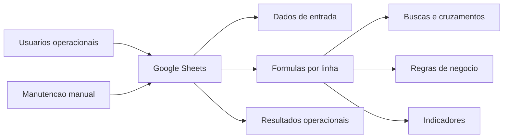

# Estado observado da estrutura baseada em planilha

## 1. Objetivo

Este documento representa a estrutura observada durante a baseline da planilha baseada em fórmulas.

O objetivo não é reproduzir o ambiente original.

A finalidade é registrar:

- responsabilidades concentradas na planilha;
- volume observado;
- dependência de fórmulas;
- riscos de manutenção;
- limites identificados;
- motivo técnico para avaliar processamento externo.

---

## 2. Visão geral

A estrutura avaliada utilizava o Google Sheets para desempenhar simultaneamente diferentes funções:

- entrada de dados;
- armazenamento;
- regras de negócio;
- tratamento de texto;
- buscas;
- contagens;
- cálculos;
- interface operacional;
- apresentação de resultados;
- suporte a integrações.

Essa concentração aumentava a dependência da estrutura interna da planilha.

---

## 3. Diagrama



---

## 4. Fallback textual

Caso o diagrama não seja renderizado:

```text
Usuários operacionais
        |
        v
Google Sheets
        |
        +--> Dados de entrada
        |
        +--> Fórmulas por linha
        |       |
        |       +--> Buscas e cruzamentos
        |       +--> Regras de negócio
        |       +--> Indicadores
        |
        +--> Resultados operacionais

Manutenção manual --> Google Sheets
```

---

## 5. Baseline estrutural

| Indicador | Resultado observado |
|---|---:|
| Linhas | 75.595 |
| Colunas | 35 |
| Células | 2.645.825 |
| Fórmulas | 146.701 |
| Densidade de fórmulas | 5,545% |
| Colunas com fórmulas | 5 |
| Células com erro | 18 |

---

## 6. Distribuição das fórmulas

| Coluna | Fórmulas |
|---|---:|
| A | 1 |
| R | 1.454 |
| S | 5.129 |
| AB | 75.594 |
| AG | 64.523 |
| **Total** | **146.701** |

A coluna AB possuía fórmula em praticamente todas as linhas e apresentava padrões misturados.

---

## 7. Funções identificadas

| Função | Ocorrências |
|---|---:|
| `IF` | 173.158 |
| `SUBSTITUTE` | 151.188 |
| `VALUE` | 75.594 |
| `XLOOKUP` | 64.523 |
| `COUNTIFS` | 5.129 |
| `IMPORTRANGE` | 1 |

Uma mesma fórmula pode conter várias funções. Por isso, a soma das ocorrências é maior que a quantidade de células com fórmula.

---

## 8. Erros encontrados

| Tipo | Quantidade |
|---|---:|
| `#REF!` | 8 |
| `#VALUE!` | 4 |
| `#ERROR!` | 6 |
| **Total** | **18** |

Os erros foram encontrados pelo inventário integral.

A amostragem periódica não encontrou erros nas regiões selecionadas, o que demonstra a diferença entre:

- amostra;
- inventário completo.

---

## 9. Fluxo de manutenção observado

A manutenção de uma regra distribuída em fórmulas pode envolver:

1. identificar a coluna;
2. localizar o padrão correto;
3. alterar a fórmula;
4. replicar a alteração;
5. verificar referências;
6. conferir linhas divergentes;
7. validar dependências;
8. acompanhar o recálculo;
9. verificar integrações dependentes.

A facilidade de editar uma célula não equivale à facilidade de manter toda a estrutura.

---

## 10. Efeito de crescimento

Uma alteração pontual pode gerar dependências sucessivas:

```text
Nova coluna
    |
    v
Nova fórmula
    |
    v
Replicação por milhares de linhas
    |
    v
Dependência em outra aba
    |
    v
Dependência em integração
    |
    v
Nova exceção operacional
```

Esse comportamento foi denominado efeito bola de neve no contexto do estudo.

---

## 11. Responsabilidades concentradas

| Responsabilidade | Presença observada |
|---|---|
| Entrada de dados | Sim |
| Armazenamento | Sim |
| Regras de negócio | Sim |
| Tratamento de texto | Sim |
| Buscas | Sim |
| Contagens | Sim |
| Indicadores | Sim |
| Interface | Sim |
| Manutenção manual | Sim |
| Dependência de fórmulas | Sim |

---

## 12. Limitações da observação

A baseline não mediu:

- tempo interno exato de recálculo;
- experiência individual de cada usuário;
- impacto de 100 usuários simultâneos;
- dependências externas não visíveis;
- custo de cada intervenção manual;
- disponibilidade anual;
- tempo total de manutenção.

A baseline mediu a estrutura e as latências observáveis pelo Apps Script.

---

## 13. Conclusão

O problema observado não era apenas a quantidade de linhas.

A complexidade estava na combinação entre:

- volume;
- fórmulas;
- repetição;
- dependências;
- padrões misturados;
- erros;
- alterações manuais;
- responsabilidades concentradas.

Essa baseline sustentou a avaliação de uma arquitetura experimental com processamento externo, validação por etapas e publicação de valores prontos.
