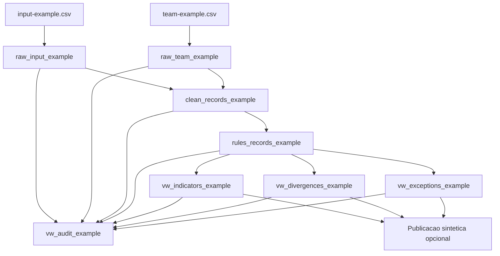
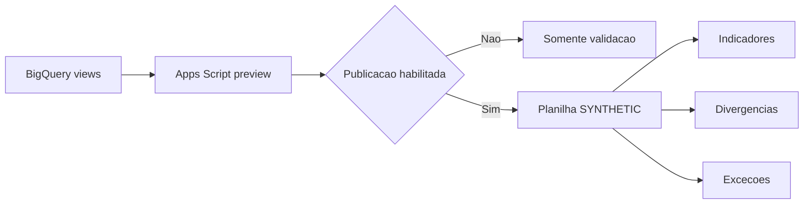

# Fluxo de dados

## 1. Objetivo

Este documento descreve o movimento dos dados no exemplo público e sanitizado.

O fluxo começa nos arquivos sintéticos e termina em:

- indicadores;
- divergências;
- exceções;
- auditoria;
- publicação opcional em planilha sintética.

---

## 2. Entradas

```text
examples/synthetic-data/input-example.csv
examples/synthetic-data/team-example.csv
```

### Fonte principal

O arquivo `input-example.csv` contém:

- 24 registros;
- 12 colunas;
- registros válidos;
- divergências;
- exceções;
- duplicidade;
- registro fora da janela.

### Referência

O arquivo `team-example.csv` contém:

- 4 equipes;
- 3 equipes ativas;
- 1 equipe inativa;
- grupos;
- capacidade;
- validade.

---

## 3. Diagrama completo



---

## 4. Fallback textual

```text
input-example.csv --------> raw_input_example ----+
                                                  |
team-example.csv ---------> raw_team_example -----+
                                                  |
                                                  v
                                      clean_records_example
                                                  |
                                                  v
                                      rules_records_example
                                         /        |        \
                                        v         v         v
                              indicators   divergences   exceptions
                                        \         |         /
                                         \        |        /
                                          v       v       v
                                         auditoria
                                              |
                                              v
                               publicação sintética opcional
```

---

## 5. Camada raw

Objetos:

```text
raw_input_example
raw_team_example
```

Responsabilidades:

- preservar o conteúdo recebido;
- manter campos como texto;
- permitir valores inválidos;
- evitar falha prematura no carregamento;
- manter rastreabilidade.

Nenhuma correção é realizada na camada raw.

---

## 6. Camada clean

Objeto:

```text
clean_records_example
```

Responsabilidades:

- remover espaços excedentes;
- normalizar capitalização;
- converter datas;
- converter inteiros;
- converter booleanos;
- converter valores numéricos;
- relacionar equipes;
- calcular hash da linha;
- identificar duplicidades;
- preservar erros de conversão.

A camada clean mantém as 24 linhas.

---

## 7. Camada de regras

Objeto:

```text
rules_records_example
```

Responsabilidades:

- validar campos obrigatórios;
- validar domínios;
- validar referências;
- validar faixas;
- aplicar regras de negócio;
- classificar duplicidade;
- classificar janela;
- definir elegibilidade.

Classificações:

```text
VALID
DIVERGENCE
EXCEPTION
DUPLICATE
OUT_OF_WINDOW
```

---

## 8. Indicadores

Objeto:

```text
vw_indicators_example
```

Entram nos indicadores:

```text
VALID
DIVERGENCE
```

Não entram nos indicadores:

```text
EXCEPTION
DUPLICATE
OUT_OF_WINDOW
```

Níveis disponíveis:

- geral;
- data;
- equipe;
- grupo;
- canal;
- campanha;
- data e equipe;
- data, equipe, canal e campanha.

---

## 9. Divergências

Objeto:

```text
vw_divergences_example
```

Granularidade:

```text
uma linha por ocorrência
```

Resultado esperado:

- 3 registros distintos;
- 4 ocorrências.

As divergências possuem estrutura técnica válida, mas apresentam combinação de negócio inconsistente.

---

## 10. Exceções

Objeto:

```text
vw_exceptions_example
```

A view consolida:

- campos ausentes;
- tipos inválidos;
- referências inválidas;
- domínios inválidos;
- valores negativos;
- duplicidade excedente;
- registro fora da janela.

Resultado esperado:

- 13 registros distintos;
- 14 ocorrências.

---

## 11. Auditoria

Objeto:

```text
vw_audit_example
```

A auditoria verifica:

- raw;
- clean;
- rules;
- paridade;
- deduplicação;
- classificação;
- indicadores;
- divergências;
- exceções;
- existência de objetos;
- expiração;
- labels.

Resultado esperado:

```text
30 checks
30 aprovados
0 reprovados
INTEGRITY_APPROVED
```

---

## 12. Publicação opcional

O Apps Script pode publicar:

- indicadores;
- divergências;
- exceções.

A publicação permanece desabilitada por padrão.

Quando habilitada, exige:

- planilha sintética;
- marcador `[SYNTHETIC]`;
- propriedade configurada;
- autorização manual;
- execução explícita;
- ausência de fórmulas.

---

## 13. Fluxo da publicação



---

## 14. Preservação das evidências

Nenhuma linha é apagada durante:

- raw;
- clean;
- rules.

A deduplicação define:

```text
is_selected_business_record
is_excess_duplicate
```

A linha excedente permanece disponível para:

- auditoria;
- exceções;
- comparação;
- rastreabilidade.

---

## 15. Contagens esperadas

```text
24 raw
24 clean
24 rules
```

Decomposição:

```text
8 VALID
3 DIVERGENCE
11 EXCEPTION
1 DUPLICATE
1 OUT_OF_WINDOW
```

Registros analisáveis:

```text
8 VALID + 3 DIVERGENCE = 11
```

---

## 16. Segurança do fluxo

O exemplo público estabelece:

- dados sintéticos;
- projeto sintético;
- dataset sintético;
- publicação desabilitada;
- gatilhos desabilitados;
- origem real proibida;
- credenciais proibidas;
- logs sanitizados;
- expiração de 59 dias.

---

## 17. Relação com os arquivos

| Camada | Arquivo |
|---|---|
| Raw | `src/sql/01_raw_example.sql` |
| Clean | `src/sql/02_clean_example.sql` |
| Rules | `src/sql/03_rules_example.sql` |
| Indicators | `src/sql/04_indicators_example.sql` |
| Exceptions | `src/sql/05_exceptions_example.sql` |
| Audit | `src/sql/06_audit_example.sql` |
| Orchestration | `src/apps-script/orchestrator.example.gs` |
| Publication | `src/apps-script/publisher.example.gs` |
| Auditor | `src/apps-script/auditor.example.gs` |

---

## 18. Conclusão

O fluxo público demonstra separação entre:

- entrada;
- preservação;
- limpeza;
- regras;
- indicadores;
- exceções;
- auditoria;
- publicação.

A separação permite identificar em qual camada uma inconsistência foi produzida ou detectada.
