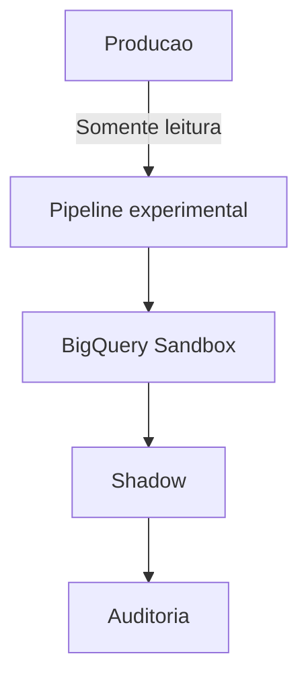
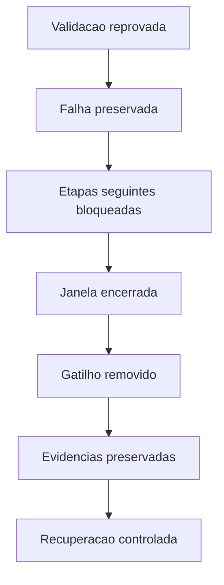

# Arquitetura do pipeline experimental

## 1. Objetivo

Este documento representa a arquitetura efetivamente avaliada durante o experimento com BigQuery Sandbox, Apps Script e publicação em ambiente shadow.

A arquitetura foi utilizada como prova técnica.

Ela não representa a arquitetura do Celebra Connect.

---

## 2. Componentes

| Componente | Responsabilidade |
|---|---|
| Fonte Google Sheets | Disponibilizar a origem em modo somente leitura |
| Apps Script | Detectar mudanças e orquestrar o fluxo |
| BigQuery Sandbox | Processar, validar e consolidar os dados |
| Tabelas candidatas | Preservar a nova geração antes da promoção |
| Tabelas oficiais | Disponibilizar a geração aprovada |
| Views | Aplicar regras e produzir resultados |
| Shadow | Receber valores processados |
| Auditoria | Validar integridade e resíduos |
| Cloud Logging | Registrar execuções e incidentes |

---

## 3. Diagrama principal

```mermaid
flowchart LR
    A["Fonte somente leitura"] --> B["Detector Apps Script"]
    B --> C["Confirmacao da mudanca"]
    C --> D["Captura"]
    D --> E["Tabelas candidatas"]
    E --> F["Views candidatas"]
    F --> G["Validacao"]
    G --> H["Backup oficial"]
    H --> I["Promocao"]
    I --> J["Validacao pos-promocao"]
    J --> K["Publicacao shadow"]
    K --> L["Validacao da publicacao"]
    L --> M["Finalizacao"]
    M --> N["Auditoria"]
```



---

## 4. Fallback textual

```text
Fonte somente leitura
        |
        v
Detector Apps Script
        |
        v
Confirmação da mudança
        |
        v
Captura
        |
        v
Tabelas candidatas
        |
        v
Views candidatas
        |
        v
Validação
        |
        v
Backup oficial
        |
        v
Promoção
        |
        v
Validação pós-promoção
        |
        v
Publicação shadow
        |
        v
Validação da publicação
        |
        v
Finalização
        |
        v
Auditoria
```

---

## 5. Separação entre ambientes



A produção não recebeu:

- escrita;
- gatilho;
- alteração estrutural;
- publicação do experimento.

---

## 6. Detecção de mudanças

O detector utilizou metadados da fonte:

- `modifiedTime`;
- hash de referência;
- identidade da fonte;
- observações sucessivas.

O detector não precisava ler todas as células a cada chamada.

A mudança precisava permanecer confirmada durante:

- 8 intervalos;
- aproximadamente 120 minutos.

---

## 7. Processamento em gerações

A nova geração não substituía imediatamente a oficial.

O fluxo utilizava:

1. captura;
2. candidata;
3. views candidatas;
4. validação;
5. backup;
6. promoção;
7. validação pós-promoção.

Esse modelo permitia bloquear o fluxo antes da publicação.

---

## 8. Publicação

A publicação transferia valores processados para a shadow.

No ciclo consolidado, foram publicados:

- 9.009 linhas;
- 114.575 células;
- zero fórmulas nas abas técnicas;
- 2.340 valores sanitizados.

A publicação foi o principal gargalo de performance observado.

---

## 9. Auditoria

A auditoria verificava:

- estado;
- ciclo;
- publicação;
- abas;
- fórmulas;
- resíduos;
- contagens;
- assinaturas;
- gatilhos;
- concessões;
- leases;
- integridade final.

Views com janela temporal móvel exigiram tratamento específico na comparação de assinaturas históricas.

---

## 10. Falha segura

Quando uma validação obrigatória falhou:



O pipeline não tentou continuar automaticamente após a falha preservada.

---

## 11. Recuperação

A recuperação validada utilizou:

- preflight;
- autorização manual temporária;
- ciclo específico;
- estado específico;
- etapa específica;
- nova janela;
- exatamente um gatilho;
- executor normal.

O recuperador não executou diretamente todas as etapas restantes.

Ele restaurou as condições para que o executor normal prosseguisse.

---

## 12. Consumo de referência

| Indicador | Resultado |
|---|---:|
| Jobs no ciclo de referência | 13 |
| Jobs com processamento | 9 |
| Bytes processados | 88.789.912 |
| Bytes faturáveis registrados | 181.403.648 |
| Percentual aproximado de 1 TiB | 0,0165% |

O projeto permaneceu sem faturamento.

---

## 13. Performance

| Métrica | Resultado |
|---|---:|
| Amostras | 30 |
| Média | 12.715,33 ms |
| Mediana | 2.269 ms |
| P95 | 62.315,15 ms |
| Máximo | 92.083 ms |
| Abaixo de 25 segundos | 86,67% |

O principal gargalo foi a publicação no Google Sheets.

---

## 14. Relação com o exemplo público

A versão sanitizada está representada em:

```text
src/sql/
src/apps-script/
examples/
evidence/
```

A versão pública:

- utiliza dados sintéticos;
- não reproduz o ambiente original;
- não contém credenciais;
- não utiliza IDs reais;
- mantém publicação desabilitada por padrão;
- não cria gatilhos automaticamente.

---

## 15. Limitações

A arquitetura experimental não comprovou:

- operação anual;
- milhares de usuários;
- streaming;
- transações em tempo real;
- disaster recovery;
- retenção permanente no Sandbox;
- substituição integral de um sistema operacional;
- uso do BigQuery no Celebra Connect.

---

## 16. Conclusão

A arquitetura demonstrou que era possível:

- detectar alterações;
- processar externamente;
- validar gerações;
- promover resultados;
- publicar valores;
- interromper falhas;
- recuperar ciclos;
- auditar;
- encerrar automaticamente.

A prova não demonstrou que a mesma arquitetura deveria ser utilizada como produto final.
