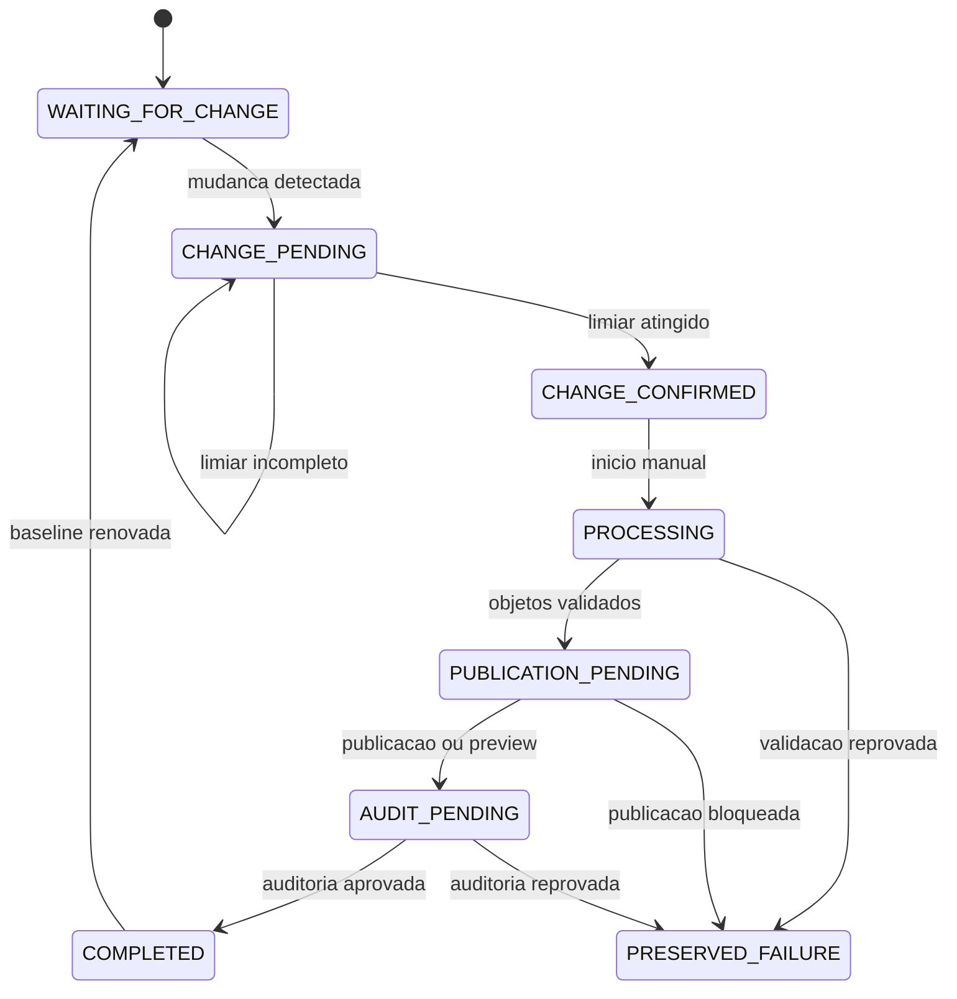

# Máquina de estados

## 1. Objetivo

Este documento descreve a máquina de estados simplificada implementada no exemplo público de Apps Script.

A máquina impede que o fluxo avance sem que a etapa anterior tenha sido validada.

---

## 2. Estados

| Estado | Finalidade |
|---|---|
| `WAITING_FOR_CHANGE` | Aguardar uma alteração confirmada |
| `CHANGE_PENDING` | Representar alteração ainda abaixo do limiar |
| `CHANGE_CONFIRMED` | Autorizar o início do ciclo |
| `PROCESSING` | Validar os objetos processados |
| `PUBLICATION_PENDING` | Preparar ou executar publicação sintética |
| `AUDIT_PENDING` | Executar auditoria |
| `COMPLETED` | Registrar conclusão do ciclo |
| `PRESERVED_FAILURE` | Impedir continuidade após falha |

---

## 3. Diagrama



---

## 4. Fallback textual

```text
WAITING_FOR_CHANGE
        |
        v
CHANGE_PENDING
        |
        v
CHANGE_CONFIRMED
        |
        v
PROCESSING
        |
        v
PUBLICATION_PENDING
        |
        v
AUDIT_PENDING
        |
        v
COMPLETED
        |
        v
WAITING_FOR_CHANGE
```

Em caso de erro nas etapas críticas:

```text
PROCESSING -----------> PRESERVED_FAILURE
PUBLICATION_PENDING --> PRESERVED_FAILURE
AUDIT_PENDING --------> PRESERVED_FAILURE
```

---

## 5. Detector e orquestrador

No exemplo público, a pendência é mantida pelo detector em uma propriedade separada.

O orquestrador permanece em:

```text
WAITING_FOR_CHANGE
```

até que o detector confirme:

- quantidade mínima de intervalos;
- quantidade mínima de minutos;
- fingerprint estável da mudança.

Depois disso, o orquestrador pode avançar para:

```text
CHANGE_CONFIRMED
```

---

## 6. Transições manuais

O exemplo público não cria gatilhos automaticamente.

Cada transição exige:

1. preflight;
2. propriedade de autorização manual igual a `true`;
3. execução de uma única função;
4. fechamento automático da autorização;
5. persistência do resultado.

A função pública é:

```text
SBSP_runNextManualStep
```

---

## 7. Transições permitidas

| Estado atual | Próximo estado | Condição |
|---|---|---|
| `WAITING_FOR_CHANGE` | `CHANGE_CONFIRMED` | Mudança atingiu o limiar |
| `CHANGE_CONFIRMED` | `PROCESSING` | Autorização manual |
| `PROCESSING` | `PUBLICATION_PENDING` | Oito objetos válidos |
| `PUBLICATION_PENDING` | `AUDIT_PENDING` | Preview ou publicação concluída |
| `AUDIT_PENDING` | `COMPLETED` | Auditoria aprovada |
| `COMPLETED` | `WAITING_FOR_CHANGE` | Baseline renovada |

---

## 8. Estado de falha preservada

O estado:

```text
PRESERVED_FAILURE
```

indica que:

- o fluxo foi interrompido;
- o erro foi persistido;
- a execução automática não deve continuar;
- as evidências devem ser analisadas;
- a retomada exige procedimento específico.

O exemplo público não oferece uma função genérica para ignorar esse estado.

---

## 9. Estrutura persistida

O estado contém:

```text
cycleId
currentState
previousState
lastAction
lastError
startedAt
updatedAt
```

Nenhum identificador real do ambiente original é utilizado.

---

## 10. Locks

As transições utilizam:

```text
Script Lock
```

O lock impede que duas execuções alterem o estado simultaneamente.

Se o lock não puder ser obtido, a nova execução não deve iniciar a transição.

---

## 11. Autorização manual

A propriedade utilizada é:

```text
SBSP_MANUAL_AUTHORIZATION
```

O comportamento esperado é:

```text
false
```

A propriedade deve ser alterada para:

```text
true
```

somente antes de uma execução manual autorizada.

Ela é fechada automaticamente no final da função.

---

## 12. Estado final

Um ciclo é considerado concluído quando:

- os objetos existem;
- a publicação foi executada ou conscientemente ignorada;
- a auditoria foi aprovada;
- o estado chegou a `COMPLETED`;
- a baseline foi renovada;
- o orquestrador voltou a `WAITING_FOR_CHANGE`.

---

## 13. Diferença para o experimento original

A máquina pública é deliberadamente reduzida.

Ela demonstra:

- estados;
- transições;
- autorização;
- persistência;
- falha segura;
- auditoria.

Ela não reproduz todas as etapas, autorizações e recuperadores do experimento original.

---

## 14. Conclusão

A máquina de estados transforma o pipeline em uma sequência verificável.

O fluxo não depende apenas da ordem em que funções são chamadas.

Ele depende de:

- estado atual;
- resultado anterior;
- autorização;
- lock;
- validação;
- auditoria.
